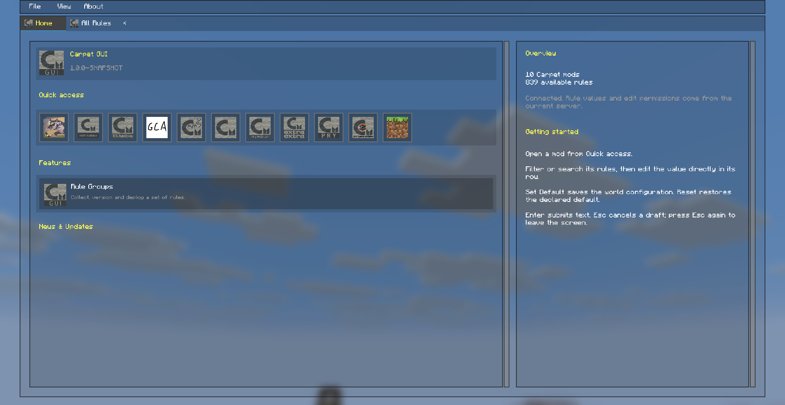
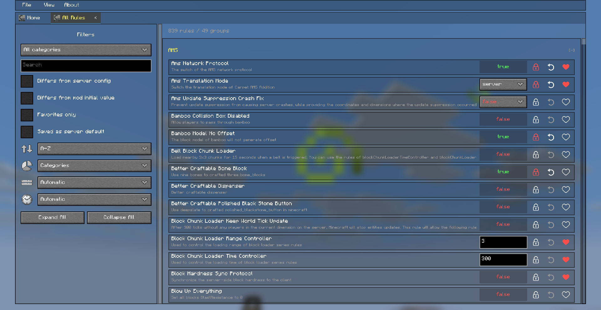
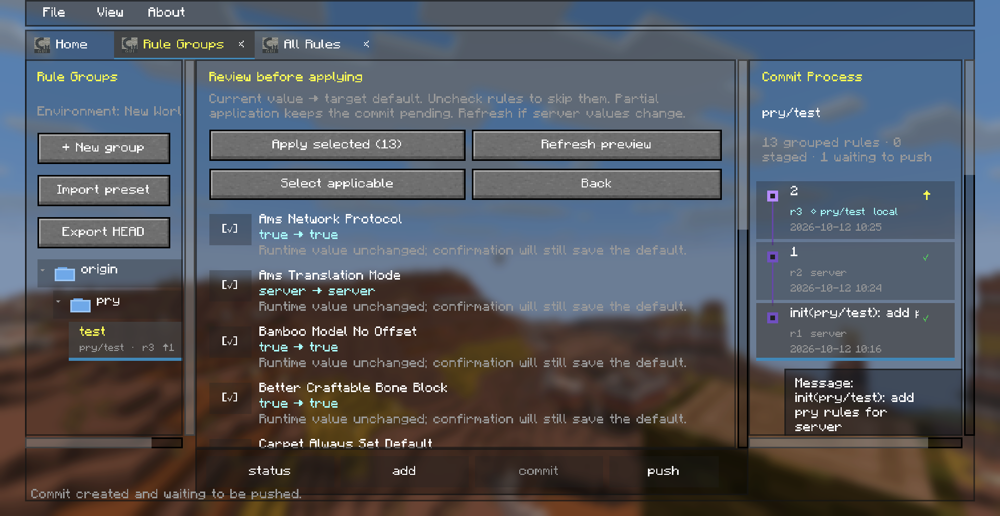

<p align="center">
  
</p>

<h1 align="center">Carpet GUI</h1>

<div align="center">

[English](../README.md) | **简体中文（当前）**

</div>

<p align="center">
  <strong>浏览规则，整理预设。</strong><br>
  面向 Carpet 及其受支持扩展模组的图形化工作区。
</p>

<p align="center">
  <a href="https://fabricmc.net/"></a>
  
  <a href="../LICENSE"></a>
</p>

<div align="center">

[安装](#安装) · [快速上手](#快速上手) · [规则分组](#规则分组与预设) · [常见问题](#常见问题) · [开发者 API](#扩展模组开发者-api) · [反馈问题](https://github.com/Piscescup/carpet-gui/issues)

</div>

---

Carpet GUI 将规则浏览、编辑和配置管理整合到游戏内的工作区中。无需记住命令，即可查找规则；将相关规则整理成可复用的分组，并在保存到服务器前检查已提交的目标值。

<p align="center">
  
  <br>
  <em>首页导航。</em>
</p>

<p align="center">
  
  <br>
  <em>全部规则预览。</em>
</p>

<p align="center">
  
  <br>
  <em>在同一个工作区中查看规则分组、应用预览和提交历史。</em>
</p>

## 功能

| 功能                    | 可以做什么                                                                           |
|-------------------------|--------------------------------------------------------------------------------------|
| 🔎 **查找规则**         | 浏览模组页面或全部规则，按规则 ID、名称和说明搜索，也支持已建立索引的中英文翻译。    |
| 🗂️ **整理工作区**       | 打开多个标签页、折叠分类、按分类或收藏筛选，并按名称或值排序。                       |
| 🎛️ **可视化编辑**       | 使用开关、选项列表和输入框修改规则；在权限允许时重置规则或保存默认值。               |
| ⭐ **收藏常用规则**     | 跨游戏会话保留常用规则，方便再次查找。                                               |
| 🌳 **建立规则分组**     | 用文件夹组织相关规则，暂存规则值，并创建带说明的本地提交。                           |
| 🕘 **查看历史**         | 点击提交查看作者、时间和规则差异；服务器支持时，悬停规则可查看观察到的玩家修改记录。 |
| 📦 **分享预设**         | 将已提交的规则值导出为 JSON，并导入其他工作区。                                      |
| ✅ **预览应用结果**     | 比较实时值与提交目标，选择要应用的规则，并查看无法应用的原因。                       |
| 🌍 **区分游戏环境**     | 为每个单人世界或多人服务器分别保存分组和提交历史。                                   |
| ⚙️ **浏览原版游戏规则** | 在受支持的 Minecraft 26.x 版本上查看和编辑原版 gamerule，操作仍受服务器权限限制。    |

## 运行要求

### 依赖模组

|                         依赖                         |              版本要求               |        是否必需        |
|:----------------------------------------------------:|:-----------------------------------:|:----------------------:|
| [Fabric Loader](https://fabricmc.net/use/installer/) |         `0.19.5` 或更新版本         |          必需          |
|  [Fabric API](https://modrinth.com/mod/fabric-api)   |     与 Minecraft 版本匹配的构建     |          必需          |
|      [Carpet](https://modrinth.com/mod/carpet)       |     与 Minecraft 版本兼容的构建     |          必需          |
|  [TCDCommons](https://modrinth.com/mod/tcdcommons)   | 与 Minecraft 版本兼容的 Fabric 构建 |          必需          |
|     [Mod Menu](https://modrinth.com/mod/modmenu)     |     与 Minecraft 版本匹配的构建     | 推荐，提供配置界面入口 |

客户端需要安装相关 Carpet 扩展模组，才能获取它们的规则定义。若要编辑服务器上的扩展规则，服务器也需要安装对应模组。

### Minecraft 与 Java 版本

当前构建配置启用了以下目标版本。请选择与 Minecraft 版本匹配的 Carpet GUI JAR。

| Minecraft 构建目标                                                     | 最低 Java 版本 |
|------------------------------------------------------------------------|----------------|
| `1.21.1`、`1.21.3`、`1.21.4`、`1.21.5`、`1.21.8`、`1.21.10`、`1.21.11` | Java 21        |
| `26.1.2`、`26.2`、`26.3`                                               | Java 25        |

`1.21.1` 构建还声明了对 Minecraft `1.21` 的兼容性。已启用的构建目标见 [settings.json](../settings.json)，各版本的依赖要求见 [versions/](../versions/)。

### 客户端与服务器安装方式

|              功能              |  仅客户端安装 Carpet GUI   | 客户端与服务器均安装 Carpet GUI  |
|:------------------------------:|:--------------------------:|:--------------------------------:|
| 规则浏览、搜索、收藏和本地分组 |            可用            |               可用               |
|      普通编辑与设置默认值      | 权限允许时使用 Carpet 命令 | 协议受支持时使用服务器确认的请求 |
|    本地提交与预设导入、导出    |            可用            |               可用               |
|      同步已保存的配置状态      |       需要服务器支持       |               可用               |
|    观察到的玩家规则修改历史    |       需要服务器支持       |         当前连接期间可用         |
|      规则分组推送完成确认      |       需要服务器支持       |      所有请求成功后确认完成      |

> [!NOTE]
> 单人游戏中，Carpet GUI 也会在内置服务器上运行，无需额外安装一个独立服务器。

## 安装

1. 为你的 Minecraft 版本安装 **Fabric Loader**。
2. 下载匹配的 **Carpet GUI**、**Fabric API**、**Carpet** 和 **TCDCommons** JAR；需要配置界面快捷入口时，也可安装 **Mod Menu**。
3. 将这些 JAR 放入游戏实例的 `mods` 文件夹。
4. 多人游戏中，如果需要服务器确认编辑结果、同步配置和验证分组推送，请在服务器上安装匹配的 Carpet GUI 及其依赖。Mod Menu 只需安装在客户端。
5. 启动 Minecraft，进入世界或服务器。

正式发布的构建可在 [Releases](https://github.com/Piscescup/carpet-gui/releases) 中查找；开发构建产物可在 [GitHub Actions](https://github.com/Piscescup/carpet-gui/actions) 中查看。

## 快速上手

1. 在游戏中按 **F9**，或通过 **Mod Menu** 打开 Carpet GUI。可以在 **选项 → 控制** 中修改快捷键。
2. 打开某个模组的规则页面或 **全部规则（All Rules）**。
3. 搜索规则、展开分类，将鼠标悬停在规则上查看说明和可用的历史记录。
4. 使用开关、选项列表或输入框编辑规则。需要持久保存受支持规则时，使用 **设置默认值（Set Default）**。
5. 打开 **规则分组（Rule Groups）**，将相关规则整理成可复用的配置。

> [!NOTE]
> 普通规则编辑会影响当前运行中的世界或服务器。本地提交只将规则值记录到工作区，不会将它们保存为服务器默认值。需要持久保存时，请使用 **设置默认值**，或审阅并确认一次分组 **push**。

## 工作区页面

|                       页面                       | 用途                                                           |
|:------------------------------------------------:|----------------------------------------------------------------|
|                 **首页（Home）**                 | 浏览工作区入口并打开规则页面。                                 |
| **全部规则 / 模组页面（All Rules / Mod Pages）** | 浏览和编辑规则，调整搜索与筛选条件，管理收藏。                 |
|           **规则分组（Rule Groups）**            | 管理分组成员、暂存和提交规则值、检查历史，以及导入或导出预设。 |
|          **应用预览（Apply Preview）**           | 在应用所选规则前，比较分组提交的目标值与服务器当前值。         |

## 规则分组与预设

### 整理分组

点击 **+ 新建分组（+ New group）** 创建分组，再通过 **管理规则（Manage rules）** 选择成员规则。分组成员与暂存值分别管理：将规则加入分组，不会自动暂存或提交它的值。

分组名称中可以使用 `/` 创建文件夹，例如 `survival/mob-farms`。分组会显示在 `origin` 根目录下；名称过长时，可以横向滚动查看。

```text
origin
├── survival
│   └── mob-farms
├── creative
│   └── testing
└── shared-settings
```

### 记录并应用规则值

```text
选择规则及其值 → status → add → commit → push → 审阅预览 → 应用已选
```

|              操作              | 作用                                                                 |
|:------------------------------:|----------------------------------------------------------------------|
|           **status**           | 显示相对于分组最新提交快照的变化，分别列出已暂存和未暂存的修改。     |
|            **add**             | 将分组当前的规则值，以及移除的成员规则，暂存到下一次提交。           |
|           **commit**           | 创建带有提交说明、作者和时间戳的本地快照。                           |
|            **push**            | 打开最新提交值的预览，准备将这些值保存为服务器默认值。               |
| **应用已选（Apply selected）** | 审阅后，请求将所选规则持久保存为默认值。验证完成状态需要服务器支持。 |

### 阅读应用预览

箭头表示 **当前运行值 → 已提交的目标默认值**，比较的不是两次提交。

|         预览         | 含义                                                         |
|:--------------------:|--------------------------------------------------------------|
|    `false → true`    | 规则当前运行值为 `false`；应用时请求将 `true` 保存为默认值。 |
|    `true → true`     | 运行值已经与目标一致；确认后仍会请求将 `true` 保存为默认值。 |
| 规则不可用或没有权限 | 预览会说明无法应用这条规则的原因。                           |

例如，在提交前先将规则编辑为 `true`，预览中就可能显示 `true → true`，因为普通编辑已经改变了实时运行值。若想查看 **两次提交之间的变化**，请点击右侧历史面板中的提交记录。

取消勾选可以跳过某条规则。**刷新预览（Refresh preview）** 会重新获取服务器当前值；分组或服务器值发生变化后，请先刷新预览。只应用部分规则时，整个提交仍会保留待推送状态。只有快照中的所有目标均成功应用并得到确认后，推送才会标记为完成。

### 分享 JSON 预设

1. 暂存并提交需要分享的规则值。
2. 点击 **导出 HEAD（Export HEAD）**。导出的内容是最新提交快照，不包含尚未提交的编辑。
3. 将导出的 JSON 文件复制到接收方游戏实例的 `config/carpet-gui/presets/` 目录。
4. 打开 **规则分组 → 导入预设（Import preset）**，选择文件，或输入带 `.json` 后缀的文件名。
5. 检查导入分组的目标值，确认应用可用的规则。

预设包含分组名称、标签和规则值，不包含服务器地址、作者身份、本地提交历史或推送状态。导入会创建一个本地分组，并在应用到服务器之前打开预览。

## 服务器功能与权限

客户端和服务器安装匹配的 Carpet GUI 后，规则编辑可以收到服务器确认的成功或拒绝结果，已保存的配置可以同步，分组应用结果也可以得到验证。

将鼠标悬停在规则上，可以查看观察到的玩家修改记录，包括玩家名称、`旧值 → 新值` 以及格式为 `[YYYY/MM/DD hh:mm:ss]` 的时间戳。较新的记录显示在上方。这些记录仅覆盖当前连接，不是永久保存的审计日志。

Carpet GUI 遵循 Carpet 的权限、规则值校验和规则锁定设置。安装本模组不会赋予额外权限。若某项编辑不可用，请查看规则提示，以及服务器的权限和配置。

批量应用不是原子操作：某些规则可能先成功，随后另一条规则失败。已成功的修改不会自动回滚；失败或未完成的推送会保留待推送状态。

## 数据存储位置

|          数据          |                                         位置                                         |
|:----------------------:|:------------------------------------------------------------------------------------:|
|  单人世界的分组与历史  |                      `<save-root>/carpet-gui/rule-groups.json`                       |
| 多人服务器的分组与历史 | `<game-instance-root>/carpet-gui/Multiplayergames_<address>_<hash>/rule-groups.json` |
|       离线工作区       |          `<game-instance-root>/config/carpet-gui/offline/rule-groups.json`           |
|        共享预设        |                  `<game-instance-root>/config/carpet-gui/presets/`                   |
|        共享收藏        |                `<game-instance-root>/config/carpet-gui/favorites.txt`                |

其中，`<save-root>` 表示世界存档根目录，`<game-instance-root>` 表示游戏实例根目录。

每个世界或服务器分别保存自己的分组、暂存状态和提交历史。预设与收藏在同一个游戏实例内共享。多人服务器的工作区数据保存在与 `config` 同级的 `carpet-gui` 目录中；单人世界的数据随存档保存。

## 常见问题

<details>
<summary><strong>服务器也需要安装 Carpet GUI 吗？</strong></summary>

浏览、收藏、本地提交和预设文件管理可在客户端使用。服务器权限允许时，普通编辑可以通过 Carpet 命令完成。如果需要服务器确认编辑结果、同步已保存配置、观察修改历史以及验证分组推送，请在客户端和服务器安装匹配的构建。

</details>

<details>
<summary><strong>为什么预览会显示 true → true？</strong></summary>

预览比较的是当前运行值和已提交的目标值。如果两者都是 `true`，运行值无需变化，但选中的规则仍会提交保存默认值的请求。若要查看历史差异，请查看右侧的提交详情。

</details>

<details>
<summary><strong>为什么某个扩展模组或规则没有显示？</strong></summary>

请检查客户端是否安装了对应扩展模组，以及它的规则定义是否可用。与其他模组共享设置管理器的扩展，可能需要显式接入 Rules API，才能显示在自己的模组页面下。同时检查并清除搜索、分类或收藏筛选条件。

</details>

<details>
<summary><strong>为什么导出的预设没有包含最新修改？</strong></summary>

**导出 HEAD** 只导出已提交的规则值。请先暂存并提交最新修改，再重新导出。

</details>

<details>
<summary><strong>为什么提交一直处于待推送状态？</strong></summary>

如果只选择了部分目标、某项操作失败，或服务器无法确认完成，提交就会保留待推送状态。请检查预览中的原因说明和反馈消息。在修改分组、服务器值或权限后，重新尝试前请先刷新预览。

</details>

<details>
<summary><strong>为什么换个世界或服务器后，分组不一样了？</strong></summary>

分组属于当前游戏环境。可以通过 JSON 预设在环境之间复制已提交的值。如果存在旧版全局分组，工作区可以提供 **复制旧分组到当前环境（Copy legacy groups）** 操作，将一份副本迁移到当前环境。

</details>

## 扩展模组开发者 API

通过 [`CarpetModRulesApi`](../src/main/java/io/github/piscescup/fabricmc/carpetgui/api/CarpetModRulesApi.java)，可以为扩展模组提供独立身份，并将它注册的 Carpet 规则关联到自己的页面。当扩展与其他模组共享设置管理器（例如 `/carpet`）时，这一点尤其有用。

编译时请依赖目标 Minecraft 版本对应的 Carpet GUI 构建。规则仍需按照 Carpet 的方式正常注册；该 API 只向 GUI 暴露已有规则，不负责注册新规则。

### 1. 提供模组信息与规则

下面的示例适用于将规则注册在 Carpet 共享设置管理器中的扩展模组。请将模组 ID、显示名称和规则名称替换为自己的内容。

```java
package com.example.addon.compat;

import carpet.CarpetServer;
import carpet.api.settings.CarpetRule;
import carpet.api.settings.SettingsManager;
import io.github.piscescup.fabricmc.carpetgui.api.CarpetModRulesApi;

import java.util.ArrayList;
import java.util.Collection;
import java.util.List;
import java.util.Set;

public final class ExampleRulesProvider implements CarpetModRulesApi {
    private static final Set<String> RULE_NAMES = Set.of("exampleRule", "anotherExampleRule");

    @Override
    public String carpetModId() {
        return "example_addon";
    }

    @Override
    public String carpetFancyName() {
        return "Example Addon";
    }

    @Override
    public Collection<CarpetRule<?>> asCarpetRules() {
        SettingsManager manager = CarpetServer.settingsManager;
        if (manager == null) return List.of();

        Collection<CarpetRule<?>> rules = new ArrayList<>();
        for (String name : RULE_NAMES) {
            CarpetRule<?> rule = manager.getCarpetRule(name);
            if (rule != null) rules.add(rule);
        }
        return rules;
    }
}
```

- `carpetModId()` 必须返回实际已安装的 Fabric 模组 ID，而不是设置管理器的命令名称。
- `carpetFancyName()` 提供页面显示名称。
- `asCarpetRules()` 必须返回属于该扩展模组、**已经注册且仍在使用的 `CarpetRule<?>` 实例**。不要返回规则名称字符串、复制的规则，或其他扩展模组的规则。
- 管理器尚未就绪时，返回空集合，不要返回 `null`。世界加载前就可能查询这个提供者。

### 2. 注册规则提供者

将以下片段合并到扩展模组的 `fabric.mod.json` 中，并保留已有的入口点和依赖配置：

```json
{
  "entrypoints": {
    "carpet-gui-mods": [
      "com.example.addon.compat.ExampleRulesProvider"
    ]
  },
  "depends": {
    "carpet-gui": "*"
  }
}
```

这个示例将 Carpet GUI 声明为必需依赖。如果希望提供可选集成，需要确保未安装 Carpet GUI 时不会加载该提供者。

已经注册的 `CarpetExtension` 也可以直接实现 `CarpetModRulesApi`，此时无需再注册 `carpet-gui-mods` 入口点。每个模组 ID 只注册一个提供者。

### 独立设置管理器

如果扩展拥有自己的设置管理器，请返回该管理器中注册的规则，而不是读取 `CarpetServer.settingsManager`。

如果扩展独占整个管理器，可以实现 [`CarpetModInfoApi`](../src/main/java/io/github/piscescup/fabricmc/carpetgui/api/CarpetModInfoApi.java)，并重写 `getSettingsManagerIds()`：

```java
@Override
public Set<String> getSettingsManagerIds() {
    return Set.of("exampleManager");
}
```

返回值必须与 `SettingsManager.identifier()` 一致。不要声明对共享管理器的完整所有权：保持这个方法的默认空集合返回值，并通过 `asCarpetRules()` 只标识属于自己的规则。

### 翻译

默认情况下，翻译从模组的 `assets/<namespace>/lang/<language>.json` 资源中读取。使用 Carpet 原有的翻译键，并以实际设置管理器标识符作为前缀。例如，属于 `/carpet` 的规则可以使用：

```json
{
  "carpet.rule.exampleRule.desc": "控制示例行为。",
  "carpet.rule.exampleRule.extra.0": "关于这条规则的补充说明。",
  "carpet.category.example": "示例"
}
```

如果扩展采用不同的资源布局，或已经通过 `CarpetExtension.canHasTranslations` 提供翻译，请重写 `getTranslations(String language)`。返回 Carpet 翻译键到文本的映射，不要修改 Carpet 的全局语言状态。

### 打开扩展模组页面

在仅客户端运行的代码中，可以使用 [`CarpetGuiScreens`](../src/main/java/io/github/piscescup/fabricmc/carpetgui/modmenu/CarpetGuiScreens.java) 创建聚焦到扩展模组的界面，例如在 Mod Menu 配置界面工厂中：

```java
return parent -> CarpetGuiScreens.create(parent, "example_addon");
```

导入 `io.github.piscescup.fabricmc.carpetgui.modmenu.CarpetGuiScreens`，并传入 Fabric 模组 ID。

## 从源码构建

使用 **JDK 25** 和项目自带的 Gradle Wrapper。主源码节点由 [versions/mainProject](../versions/mainProject) 指定；[settings.json](../settings.json) 决定启用哪些 Minecraft 构建目标。预处理器会从共享源码树生成对应版本的源码。

以下命令均在仓库根目录执行。

构建单个目标版本：

```sh
./gradlew :26.2:build
```

构建所有已启用的目标，并将模组 JAR 汇总到 `../build/release`：

```sh
./gradlew buildAndGather
```

检查所有已启用的目标：

```sh
./gradlew checkAllVersions
```

在 Windows PowerShell 中，请将 `./gradlew` 替换为 `.\gradlew.bat`。单个目标的输出位于 `versions/<version>/build/libs/`。本地构建默认带有 `-SNAPSHOT` 后缀；使用 `-Prelease=true` 可以采用发布版本命名。

## 致谢

特别感谢 [TheCSDev](https://github.com/TheCSDev)。
Carpet GUI 的 UI 设计参考了其作品 [Better Statistics Screen](https://github.com/TheCSDev/betterstats)，
工作区界面则由其开发的 [TCDCommons](https://modrinth.com/mod/tcdcommons) GUI 框架提供支持。

同时感谢 [Fabric](https://fabricmc.net/)、[Carpet](https://modrinth.com/mod/carpet) 和 [Mod Menu](https://modrinth.com/mod/modmenu) 的开发者与维护者，
为本项目提供模组平台、规则系统和集成工具。[ReplayMod Preprocessor](https://github.com/ReplayMod/preprocessor) 及 [Fallen-Breath 的分支](https://github.com/Fallen-Breath/preprocessor) 使共享源码树的多版本构建成为可能。

也感谢每一位参与测试、反馈问题、提出改进建议，
以及贡献代码和翻译的朋友。

## 反馈与贡献

欢迎通过 [Issues](https://github.com/Piscescup/carpet-gui/issues) 和 [Pull Requests](https://github.com/Piscescup/carpet-gui/pulls) 反馈问题或提交贡献。
报告问题时，请提供 Minecraft 与 Carpet GUI 版本、相关依赖和扩展模组版本、服务器是否安装 Carpet GUI，
以及复现步骤。界面或兼容性问题可以附上截图及相关日志片段。

## 项目依赖与许可证

Carpet GUI 基于 [Fabric](https://fabricmc.net/)、[Carpet](https://modrinth.com/mod/carpet) 和 [TCDCommons](https://modrinth.com/mod/tcdcommons) 构建，
并可选集成 [Mod Menu](https://modrinth.com/mod/modmenu)。
多版本构建使用 [ReplayMod Preprocessor](https://github.com/ReplayMod/preprocessor) 和 
[Fallen-Breath 的分支](https://github.com/Fallen-Breath/preprocessor)。

本项目许可证使用 [LGPL v3.0](../LICENSE)。
